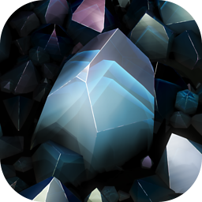

<p align="center">
	
</p>

<h1 align="center">Enki Shader Editor</h1>

<p align="center">
	<b>Sketch with shaders. Nudge a number. See what happens.</b>
</p>

<p align="center">
	<a href="https://danwills.github.io/EnkiShaderEditor/">Website</a> ·
	<a href="https://danwills.github.io/EnkiShaderEditor/enki/">Download the APK</a> ·
	<a href="FAQ.md">FAQ</a> ·
	<a href="https://github.com/danwills/EnkiShaderEditor/issues">Issues</a>
</p>

A [GLSL](https://en.wikipedia.org/wiki/GLSL) editor for Android where the
shader runs behind your code while you write it. Shaders can read touch,
motion sensors, the camera, sound and their own previous frame, so there's
plenty to poke at. Keep one as your live wallpaper, or save stills, frame
sequences and MP4s of what you find. Free and open source.

Enki is a fork of Markus Fisch's
[ShaderEditor](https://github.com/markusfisch/ShaderEditor), built for
wandering around inside shaders. It installs alongside the original app.

<p align="center">
	
	
	
</p>

## Things to play with

* **Live preview.** The shader runs behind your code, so changes show up as
	you write. Very slow shaders are drawn a band at a time, so the phone stays
	responsive while you wait.
* **Adjust Defines.** A shader's `#define`s become sliders, vector fields and
	colour pickers, live while it runs.
* **Multipass.** ShaderToy-style buffer passes with a Common section, Sound
	passes, and shaders that keep state in their own pixels through pauses,
	rotations and resolution changes.
* **Syntax and error highlighting.** Compile errors are marked where they
	happen. Undo/redo, keyword completions, auto-indent, find, and hotkeys for
	a hardware keyboard.
* **Inputs.** Up to 10 touch points, motion sensors, the front or back
	camera as a live texture, battery level and wallpaper offset.
* **Sound.** The microphone level, or a ShaderToy-style `audioSpectrum` from
	the microphone or from audio playing on the phone. Tracker modules (MOD,
	S3M, XM) play in time with the shader.
* **Textures.** Bring in your own images as 2D textures or build cube maps,
	plus built-in font and colour-map textures.
* **Captures.** Stills far beyond screen resolution (tiled, oversampled),
	frame sequences and MP4s.
* **Live wallpaper.** Keep a shader running on your home screen.
* **Shader packs.** Bundle a set of shaders into a single file to share, and
	install packs from a file.

[What's new since ShaderEditor](docs/enki-since-markus.md) has the details,
and the [website](https://danwills.github.io/EnkiShaderEditor/) has videos
of all of this, plus example shaders to paste in and start changing.

## Download

For now Enki is available as a direct APK download from the
[website](https://danwills.github.io/EnkiShaderEditor/enki/). It needs
Android 7.0 or later. Future builds are signed with the same certificate,
so they install as updates and keep your shaders.

The F-Droid and Google Play listings named Shader Editor are for Markus's
original app, not Enki.

## Support

If you enjoy Enki, you can support its development on
[Patreon](https://www.patreon.com/ultraiterator). Markus Fisch, the
original author, takes support through
[Buy Me a Coffee](https://www.buymeacoffee.com/markusfisch) and
[Liberapay](https://liberapay.com/markusfisch/).

## Building

```sh
./gradlew assembleEnkiDebug     # or: make debug
make install                    # install the debug build over adb
```

See [CLAUDE.md](CLAUDE.md) for the other build commands and
[AGENTS.md](AGENTS.md) for a map of the code. The repository also builds a
second app, Ultra Rest Area ([docs/ultra-rest-area.md](docs/ultra-rest-area.md)),
from the same code.

## Third-party code and assets

* Tracker module playback (MOD, S3M, XM) uses [IBXM](https://github.com/martincameron/micromod)
	by Martin Cameron, under the [BSD-3-Clause licence](app/src/main/java/ibxm/LICENCE) - see
	`app/src/main/java/ibxm/README.md`.

* The built-in `font` texture is rendered from
	[IBM Plex Mono](https://github.com/IBM/plex), Copyright © 2017 IBM Corp., under the
	[SIL Open Font License 1.1](tools/font/OFL.txt) - see `tools/font/make_atlas.py`.

* The built-in `colormaps` texture holds the
	[CET Perceptually Uniform Colour Maps](https://colorcet.com) by Peter Kovesi, under
	[CC BY 4.0](https://creativecommons.org/licenses/by/4.0/) (the newest via the
	[colorcet](https://github.com/holoviz/colorcet) package), and Ready's colour maps: ColorBrewer's
	(Apache 2.0, from VTK) and matplotlib's inferno (CC0) - see
	`app/src/main/res/raw/colormaps_license.txt` and `tools/colormaps/make_atlas.py`.

## Licence

MIT, as the original - see [LICENSE](LICENSE).
